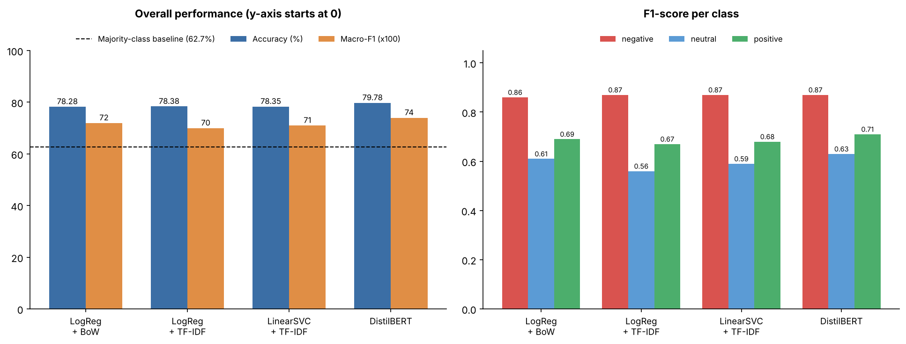

# Eunice Agogo: Data and AI Portfolio

BBA student in Big Data, AI and Management at **Audencia Business School** (Nantes, France), with an exchange semester at **École Centrale Casablanca** (March–May 2026). This repository collects my coursework projects, each with its method, results and limitations written up.

---

## Featured project

### [Sentiment Analysis of US Airline Tweets](nlp/airline-sentiment)
Classified **14,640 tweets** into negative, neutral and positive, comparing Bag of Words and TF-IDF with Logistic Regression and SVM against a fine-tuned **DistilBERT**.

- DistilBERT: **79.78% accuracy, 0.74 macro-F1**; the three classical models: 78.3–78.4% accuracy
- Reported **macro-F1** because 62.7% of tweets are negative, which makes accuracy alone misleading
- Honest about limits: a single train/test split, and DistilBERT fed text with stop words removed

[](nlp/airline-sentiment)

**[Read the full write-up →](nlp/airline-sentiment)**

---

## Other coursework

| Project | What it shows |
|---|---|
| [Text Preprocessing Lab](nlp/text-preprocessing-lab) | Text normalisation with regular expressions and spaCy: lowercasing, number and punctuation removal, tokenisation, stop words |

## Tools used in this repository

Python · pandas · scikit-learn · NLTK · spaCy · PyTorch · Hugging Face Transformers · Matplotlib · Seaborn · Git and GitHub

## Currently building

I am working toward a career in **data engineering**: pipelines, data modelling and warehousing, orchestration and cloud. The next project here will be an end-to-end data pipeline.

## Repository structure

```
coursework-portfolio/
├── README.md
├── requirements.txt
├── .gitignore
└── nlp/
    ├── airline-sentiment/       # featured project with notebook, figures and write-up
    └── text-preprocessing-lab/  # short NLP lab
```

## Connect

- LinkedIn: [linkedin.com/in/eunice-agogo](https://www.linkedin.com/in/eunice-agogo)
- GitHub: [grithubber8](https://github.com/grithubber8)

## Run the code

Each project folder has its own README with instructions. Shared Python dependencies are in `requirements.txt`.
