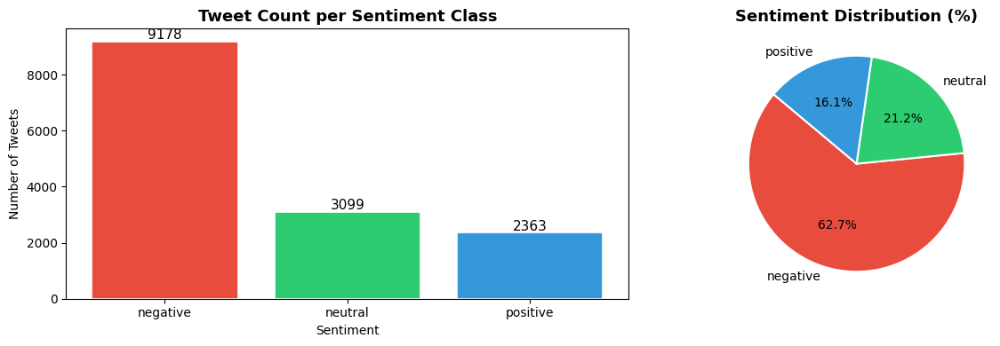
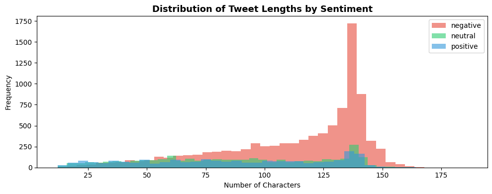
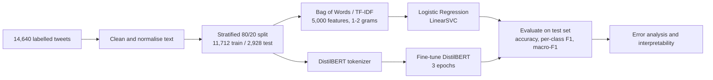
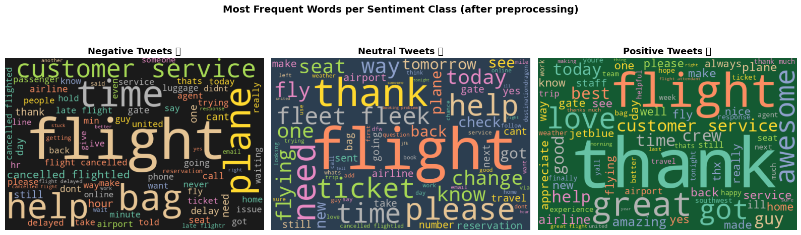
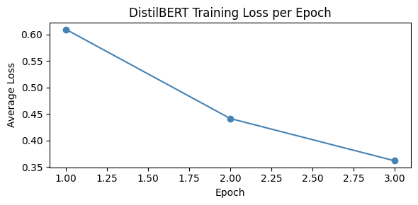
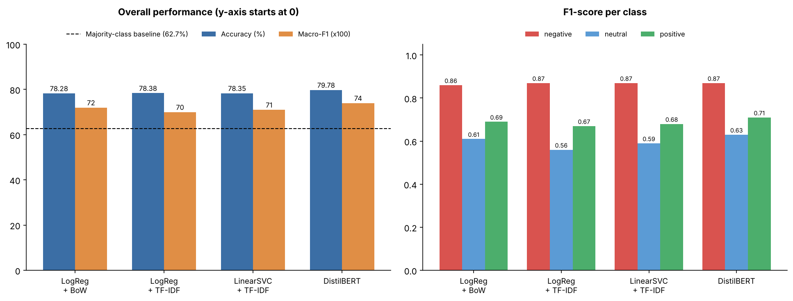
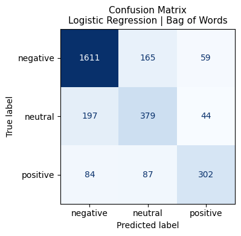
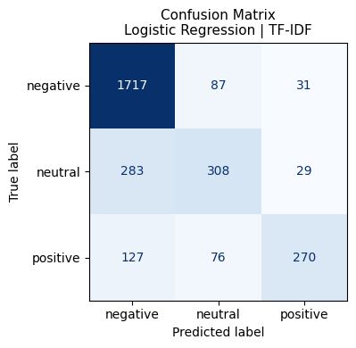
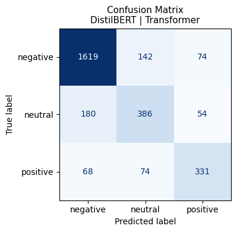
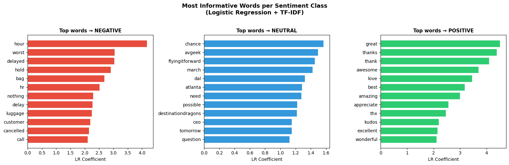

# Sentiment Analysis of US Airline Tweets

Classifying 14,640 customer tweets as **negative, neutral or positive**, and comparing classical machine learning (Bag of Words, TF-IDF with Logistic Regression and SVM) against a fine-tuned transformer (**DistilBERT**).


**Headline result:** DistilBERT reached **79.78% accuracy and 0.74 macro-F1** on a held-out test set of 2,928 tweets, against 78.3–78.4% accuracy for the three classical models. The gap is small enough that one train/test split cannot prove it is real (see [Limitations](#limitations-and-what-i-would-do-next)).

---

## Contents
1. [Problem and data](#problem-and-data)
2. [Pipeline](#pipeline)
3. [Preprocessing](#preprocessing)
4. [Models](#models)
5. [Results](#results)
6. [What the results say](#what-the-results-say)
7. [Error analysis and interpretability](#error-analysis-and-interpretability)
8. [Design decisions](#design-decisions)
9. [Limitations and what I would do next](#limitations-and-what-i-would-do-next)
10. [How to reproduce](#how-to-reproduce)
11. [Credits](#credits)

---

## Problem and data

Airlines receive thousands of tweets a day. Automatically telling complaints from praise from neutral chatter lets a customer-service team prioritise.

- **Dataset:** the public *Twitter US Airline Sentiment* dataset, 14,640 labelled tweets about six US airlines (Kaggle: [crowdflower/twitter-airline-sentiment](https://www.kaggle.com/datasets/crowdflower/twitter-airline-sentiment)). The data is not included in this repository, so download `Tweets.csv` from the source and check its licence terms.
- **Classes:** negative 9,178 (62.7%), neutral 3,099 (21.2%), positive 2,363 (16.1%).
- **Why this matters:** the classes are heavily imbalanced. A model that always predicts "negative" scores **62.7% accuracy** while being useless, which is why this project reports **macro-F1** (the F1-score averaged equally over the three classes) next to accuracy.



Negative tweets are also noticeably longer (mean 114 characters) than neutral (87) or positive (86) ones.



## Pipeline



## Preprocessing

Each tweet goes through the same function:

| Step | Operation | Why |
|---|---|---|
| 1 | Remove @mentions | Airline handles carry no sentiment |
| 2 | Remove URLs and HTML entities | Noise |
| 3 | Strip `#` but keep the word | The hashtag text can carry meaning |
| 4 | Lowercase, remove punctuation and numbers | Merge variants of the same word |
| 5 | Tokenise (NLTK) | Split into words |
| 6 | Remove stop words and tokens of 2 letters or fewer | Reduce noise and vocabulary size |
| 7 | Lemmatise (WordNet) | Map *delayed*, *delays* to *delay* |

Real examples from the run:

| Original | Cleaned |
|---|---|
| `@VirginAmerica seriously would pay $30 a flight for seats that didn't have this playing. it's really the only bad thing about flying VA` | `seriously would pay flight seat didnt playing really bad thing flying` |
| `@VirginAmerica did you know that suicide is the second leading cause of death among teens 10-24` | `know suicide second leading cause death among teen` |



> **Known weakness:** NLTK's stop-word list includes negations such as "not", so "not great" becomes "great". This is discussed under [Limitations](#limitations-and-what-i-would-do-next).

## Models

All models use a stratified 80/20 split with `random_state=42`. Vectorisers are fitted on the training set only, to avoid data leakage.

| Model | Features | Settings |
|---|---|---|
| Logistic Regression | Bag of Words | 5,000 features, unigrams + bigrams, C=1.0, max_iter=1000 |
| Logistic Regression | TF-IDF | same vocabulary settings, C=1.0, max_iter=1000 |
| SVM (LinearSVC) | TF-IDF | C=1.0, max_iter=2000 |
| DistilBERT (`distilbert-base-uncased`) | Sub-word tokens, max length 128 | 3 epochs, batch size 32, learning rate 2e-5, AdamW, linear schedule, gradient clipping at 1.0, trained on a GPU |

A GloVe-embedding model (averaged spaCy word vectors) is implemented in the notebook but was **not evaluated**, because the spaCy vector model was unavailable in the run.



## Results

Test set of 2,928 tweets.

| Model | Features | Accuracy | Macro-F1 | F1 negative | F1 neutral | F1 positive |
|---|---|---|---|---|---|---|
| Logistic Regression | Bag of Words | 78.28% | 0.72 | 0.86 | 0.61 | 0.69 |
| Logistic Regression | TF-IDF | 78.38% | 0.70 | 0.87 | 0.56 | 0.67 |
| SVM (LinearSVC) | TF-IDF | 78.35% | 0.71 | 0.87 | 0.59 | 0.68 |
| **DistilBERT** | Transformer | **79.78%** | **0.74** | 0.87 | **0.63** | **0.71** |

*Majority-class baseline: 62.7% accuracy.*



Confusion matrices (rows are the true class, columns the predicted class):

| Logistic Regression + BoW | Logistic Regression + TF-IDF |
|:---:|:---:|
|  |  |
| **SVM + TF-IDF** | **DistilBERT** |
|  |  |

## What the results say

1. **DistilBERT is best on both metrics, but only by a little.** It leads the best classical model by about 1.4 accuracy points. On 2,928 test tweets, a rough 95% binomial interval on each accuracy is about ±1.5 points (my back-of-envelope estimate), so a single split cannot establish that the gap is statistically meaningful.
2. **The three classical models are practically tied** on accuracy (78.28–78.38%). TF-IDF did not beat Bag of Words, and the SVM did not beat Logistic Regression. Bag of Words even has the higher macro-F1, because the TF-IDF logistic regression recalls fewer neutral tweets (0.50 against 0.61).
3. **The neutral class is the bottleneck for every model** (F1 0.56–0.63, against 0.86–0.87 for negative). DistilBERT's advantage is concentrated on the neutral and positive classes.
4. **Every model beats the majority baseline by about 16–17 points**, so the models learned real signal and not just the class imbalance.

## Error analysis and interpretability

SVM + TF-IDF misclassified **634 of 2,928 tweets (21.7%)**. Some sampled errors:

| Cleaned tweet | True | Predicted | Likely reason |
|---|---|---|---|
| `thanks getting back find airline future` | negative | positive | Polite wording around a complaint, or a noisy label |
| `take look status sitting ord aint cool` | negative | positive | Negative meaning carried by phrasing that word counts miss |
| `hold minute please help` | neutral | negative | "Hold" and "help" are strongly associated with complaints |
| `need vacation ice` | neutral | negative | Ambiguous even to a human reader |

Reading these, some errors look like **ambiguous or noisy labels** and others depend on negation or tone that word-count features cannot represent. This is my interpretation of a small sample of ten errors, not a systematic study.

The Logistic Regression coefficients show which words push a tweet toward each class:



Negative is driven by delay vocabulary (*hour*, *worst*, *delayed*, *luggage*, *cancelled*) and positive by gratitude and praise (*great*, *thanks*, *awesome*). The neutral class is dominated by topical or named tokens (*avgeek*, *atlanta*), which suggests it is defined more by topic than by sentiment.

## Design decisions

| Decision | Reason |
|---|---|
| Stratified split | Keeps the 63/21/16 class ratio identical in train and test, so the metrics are comparable |
| Fit vectorisers on the training set only | Prevents vocabulary and IDF statistics from the test set leaking into training |
| Unigrams + bigrams | Captures short phrases such as "customer service" that single words miss |
| Macro-F1 as the main metric | Treats the three classes equally, so a model cannot score well by favouring the majority |
| Two linear models on the same features | Isolates the effect of the learning algorithm from the effect of the features |
| DistilBERT instead of full BERT | About 40% smaller and faster to fine-tune, which fits a single GPU session |
| Gradient clipping and a linear learning-rate schedule | Standard practice to stabilise transformer fine-tuning |

## Limitations and what I would do next

1. **Single split, single seed.** Next: stratified k-fold cross-validation, reporting mean ± standard deviation.
2. **Stop-word removal also removes negations.** Next: keep negation words in the classical pipeline.
3. **DistilBERT was fed the same preprocessed text** (stop words removed, lemmatised) and not the raw tweets it was pre-trained on, which probably understates its potential. Next: re-run it on raw text. This is the experiment I would prioritise, because it could change the headline comparison.
4. **GloVe embeddings were not evaluated.** Next: install the spaCy vectors and complete the comparison.
5. **No hyper-parameter tuning and no explicit imbalance handling** (no class weights or resampling).
6. **The dataset's labelling-confidence column was not used**, although it could help filter noisy labels.

## How to reproduce

The notebook was run on **Google Colab** (it uses Colab's file-upload widget and a GPU for DistilBERT).

1. Download `Tweets.csv` from the Kaggle dataset linked above.
2. Open `airline_sentiment_analysis.ipynb` in Colab (upload it, or open it from this GitHub repository).
3. Switch on the GPU: **Runtime → Change runtime type → GPU**.
4. Run all cells and upload `Tweets.csv` when prompted.
5. Optional, to also run the embedding model: run `python -m spacy download en_core_web_md` in a cell first.

To run locally instead, install the dependencies with `pip install -r ../../requirements.txt` and replace the Colab upload cell with `pd.read_csv("Tweets.csv")`.

## Repository contents

```
airline-sentiment/
├── airline_sentiment_analysis.ipynb   # full analysis with saved outputs
├── README.md                          # this page
└── figures/                           # charts used above
```

## Credits

Course project for the Natural Language Processing course at École Centrale Casablanca (May 2026), by Eunice Agogo.
